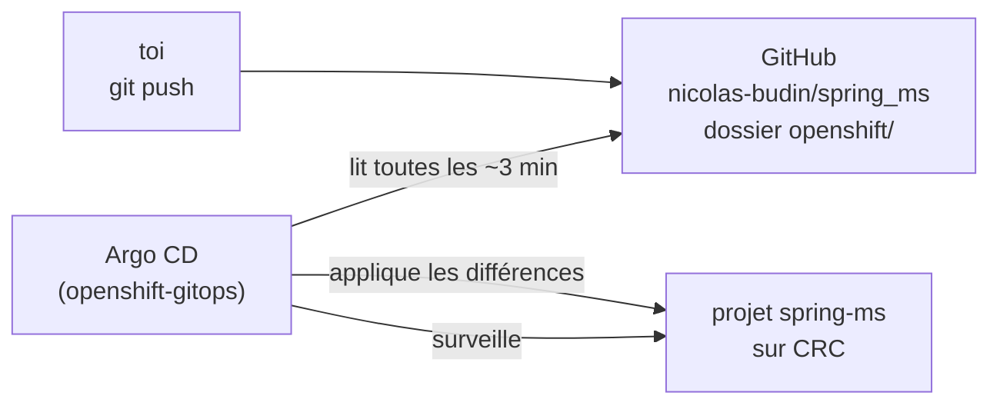

# OpenShift avec Argo CD : déploiement GitOps

Dans les guides [impératif](openshift-imperatif.md) et [déclaratif](openshift-declaratif.md), c'est toi qui appliques les changements au cluster (`oc new-app`, `oc apply`). Ici, c'est **Argo CD** qui s'en charge, en lisant le dépôt Git.



C'est le principe du **GitOps** : **Git est la source de vérité**.

- **Pour changer quelque chose,** on modifie un fichier, on commite et on pousse. Argo CD applique le changement.
- **Si quelqu'un modifie le cluster à la main,** Argo CD remet l'état décrit dans Git (*selfHeal*).
- **Si on supprime un fichier de Git,** Argo CD supprime l'objet correspondant du cluster (*prune*).

## Ce qui est en place

| Fichier | Rôle |
|---|---|
| [argocd/application.yaml](../argocd/application.yaml) | l'**Application** Argo CD : « déploie le dossier `openshift/` du dépôt dans le projet `spring-ms` ». C'est le seul fichier appliqué à la main, une seule fois. |
| [openshift/*.yaml](../openshift/) | les manifests : RabbitMQ, les 3 services, Prometheus et Grafana. Argo CD applique tous les `.yaml` du dossier. |

L'opérateur **Red Hat OpenShift GitOps** (Argo CD) est déjà installé sur le CRC : son instance tourne dans le namespace `openshift-gitops`. Les applications `hello-world-*` et `ollama-agent` l'utilisent déjà.

### L'Application en détail

```yaml
source:
  repoURL: https://github.com/nicolas-budin/spring_ms.git
  targetRevision: main          # la branche suivie
  path: openshift               # le dossier lu
destination:
  namespace: spring-ms          # où déployer
syncPolicy:
  automated:
    prune: true                 # objet retiré de Git → supprimé du cluster
    selfHeal: true              # modification à la main → annulée
```

- **`managedNamespaceMetadata`** pose le label `argocd.argoproj.io/managed-by: openshift-gitops` sur le namespace. Sans ce label, l'instance Argo CD d'OpenShift n'a pas le droit d'y créer des objets.
- **`ignoreDifferences`** est expliqué plus bas, à l'étape 5.

### Les ConfigMaps de Prometheus et Grafana

Argo CD n'applique que des fichiers présents dans Git. Les commandes `oc create configmap --from-file=...` ne peuvent donc plus servir. Les ConfigMaps sont maintenant écrites **en entier** en tête de [prometheus.yaml](../openshift/prometheus.yaml) et de [grafana.yaml](../openshift/grafana.yaml).

Leur contenu est une **copie** des fichiers de `observability/`, que docker-compose utilise aussi. Si tu modifies l'un, il faut modifier l'autre. Un commentaire le rappelle en tête de chaque ConfigMap.

## Étapes

### 1. Pousser les manifests dans Git

Argo CD lit GitHub, pas ton disque. Tout changement doit donc être poussé :

```bash
cd ~/github/spring_ms
git add openshift/ argocd/ docs/openshift-argocd.md
git commit -m "Argo CD : ConfigMaps Prometheus/Grafana et Application"
git push
```

### 2. Ouvrir la console Argo CD

```bash
oc get route openshift-gitops-server -n openshift-gitops
```

L'adresse est <https://openshift-gitops-server-openshift-gitops.apps-crc.testing>. Clique sur **Log in via OpenShift** et connecte-toi en kubeadmin. Tu y vois déjà tes applications `hello-world-*` et `ollama-agent`.

### 3. Créer l'Application

```bash
oc apply -f argocd/application.yaml
```

C'est la **seule** commande `oc apply` de ce guide. Ensuite, c'est Argo CD qui applique.

Dans la console Argo CD, la tuile **spring-ms** apparaît. Clique dessus pour voir l'arbre des ressources : Deployments, Services, Routes, ConfigMaps, BuildConfigs…

**Les objets déjà présents ne sont pas recréés.** Ceux que tu as créés avec `oc apply -f openshift/` portent les mêmes noms qu'Argo CD les a dans Git : il les **reprend** et les met simplement à jour. Il ajoute ses labels de suivi, et les ConfigMaps passent sous gestion déclarative.

Statut attendu au bout de quelques secondes : **Synced** (le cluster est identique à Git) et **Healthy** (les pods sont prêts).

En ligne de commande :

```bash
oc get application spring-ms -n openshift-gitops
```

### 4. Construire les images (inchangé)

Les builds restent **binaires** : le code Java est envoyé depuis ton poste, pas lu dans Git.

```bash
oc start-build notification-service --from-dir=. --follow
oc start-build user-service         --from-dir=. --follow
oc start-build frontend             --from-dir=. --follow
```

Argo CD gère les BuildConfigs et les ImageStreams, mais il ne **lance pas** les builds. Quand tu modifies le code Java, il faut donc toujours lancer `oc start-build` toi-même.

### 5. Pourquoi `ignoreDifferences`

Dans Git, chaque Deployment demande `image: notification-service:latest`. Après un build, le déclencheur `image.openshift.io/triggers` remplace ce champ par l'adresse exacte de l'image construite :

```
image-registry.openshift-image-registry.svc:5000/spring-ms/notification-service@sha256:...
```

Sans règle particulière, Argo CD verrait que le cluster ne correspond plus à Git. Avec `selfHeal`, il remettrait `notification-service:latest`, puis le déclencheur réécrirait le champ, et ainsi de suite, **en boucle**.

La règle `ignoreDifferences` sur `.spec.template.spec.containers[].image` dit à Argo CD : « ce champ appartient à OpenShift, ne le compare pas ».

## Tester le GitOps

### Une modification passe par Git

Dans [openshift/frontend.yaml](../openshift/frontend.yaml), passe `replicas: 1` à `replicas: 2` (le front n'a pas de base H2, il peut avoir 2 pods). Puis :

```bash
git commit -am "front : 2 replicas" && git push
```

Argo CD vérifie le dépôt **toutes les 3 minutes environ**. Pour ne pas attendre, clique sur **Refresh** dans la console. Un 2ᵉ pod frontend apparaît alors.

### selfHeal : le cluster revient à l'état de Git

```bash
oc scale deploy/frontend --replicas=5
oc get pods -l app=frontend -w
```

Les pods supplémentaires démarrent, puis Argo CD remet le nombre de replicas indiqué dans Git, en quelques secondes.

Même chose si tu supprimes un objet : `oc delete route frontend`, et la Route est recréée.

**Conséquence :** `oc edit`, `oc patch` et `oc scale` ne servent plus à rien sur les objets gérés par Argo CD. La seule façon de changer durablement le cluster, c'est Git.

### prune : retirer un objet

Si un fichier est supprimé de `openshift/`, ou un objet retiré d'un fichier, Argo CD supprime l'objet du cluster au prochain push.

## Modifier Prometheus ou Grafana

1. Modifier le fichier dans `observability/`, pour docker-compose, **et** sa copie dans la ConfigMap de `openshift/prometheus.yaml` ou `openshift/grafana.yaml`.
2. `git commit` puis `git push` : Argo CD met la ConfigMap à jour.
3. Prometheus et Grafana ne relisent leur configuration qu'au démarrage. Il faut donc les redémarrer :

   ```bash
   oc rollout restart deploy/grafana
   ```

   Cette commande ne modifie pas le Deployment décrit dans Git : elle recrée seulement les pods. Argo CD ne la contredit donc pas.

## Ce qui reste hors d'Argo CD

| Élément | Pourquoi |
|---|---|
| l'Application elle-même (`argocd/application.yaml`) | elle est appliquée une seule fois, à la main. C'est le point de départ. |
| la construction des images | builds binaires depuis ton poste (`oc start-build --from-dir=.`) |

Pour aller plus loin :

- passer les BuildConfigs en source `Git` (voir le [guide déclaratif](openshift-declaratif.md#pour-aller-plus-loin--construire-depuis-git)), pour que les images soient construites depuis le même dépôt ;
- ou utiliser **OpenShift Pipelines** (Tekton, déjà installé sur le CRC), pour construire automatiquement à chaque push.

## Supprimer

```bash
oc delete application spring-ms -n openshift-gitops
```

Par défaut, supprimer l'Application **laisse les objets** dans le cluster. Pour tout supprimer, supprime aussi le projet : `oc delete project spring-ms`.
