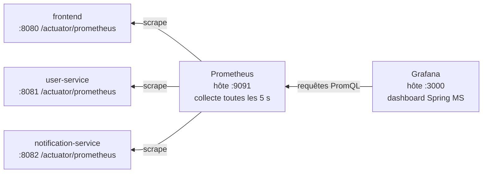

# Plan — Observabilité spring-ms

27 octobre 2026 · Statut : implémenté, sans les métriques métier (retirées après coup, voir plus bas).

## Contexte

Les 3 services (frontend, user-service, notification-service) exposeront leurs métriques d'utilisation : Prometheus les collecte toutes les 5 s et Grafana les affiche dans un tableau de bord « Spring MS ».

Le choix retenu est **Actuator + Micrometer** dans chaque service, **Prometheus** pour la collecte et **Grafana** pour la visualisation, le tout lancé par `docker-compose.yml`. Les traces distribuées et les logs centralisés ne sont pas inclus.

## Côté services

Chaque service publie `/actuator/prometheus`, qui couvre sans code les requêtes REST, les appels gRPC, la JVM et le pool de connexions H2.

**Dépendances** (`pom.xml` des 3 modules) : `spring-boot-starter-actuator` et `io.micrometer:micrometer-registry-prometheus`, versions gérées par Spring Boot 4.1.2.

**Configuration** (`application.yml` de chaque service) :

```yaml
management:
  endpoints.web.exposure.include: health,info,metrics,prometheus
  metrics:
    tags.application: ${spring.application.name}
    distribution.percentiles-histogram:
      http.server.requests: true
      http.client.requests: true
      grpc.server: true
      grpc.client: true
```

Le tag `application` permet de filtrer par service dans Grafana ; les histogrammes donnent les latences p95. Les métriques gRPC existent déjà : Spring gRPC active l'observation par défaut.

**Métriques métier** : finalement non retenues. Les 3 compteurs prévus (`users.registered`, `notifications.welcome`,
`notifications.stored`) ont été implémentés puis retirés à la demande : seules les métriques fournies automatiquement
par Spring Boot sont conservées. Les échecs d'envoi vers notification-service restent visibles dans les métriques
gRPC côté client (`grpc_client_seconds_count{grpc_status_code="UNAVAILABLE"}`).

**Tests** : `UserControllerTests` vérifie que `/actuator/prometheus` répond et contient les métriques HTTP et gRPC.

## Infra d'observabilité

Les fichiers de configuration vont dans un nouveau dossier `observability/` ; Grafana est entièrement provisionné, sans clic manuel au premier démarrage.



Les flèches vont de celui qui interroge vers celui qui répond : Prometheus lit les services, Grafana lit Prometheus.

| Fichier | Contenu |
| --- | --- |
| `observability/prometheus/prometheus.yml` | Collecte toutes les 5 s de `frontend:8080`, `user-service:8081`, `notification-service:8082` sur `/actuator/prometheus` |
| `observability/grafana/provisioning/datasources/prometheus.yml` | Source de données Prometheus (`http://prometheus:9090`) |
| `observability/grafana/provisioning/dashboards/dashboards.yml` | Chargement automatique des dashboards du dossier |
| `observability/grafana/dashboards/spring-ms.json` | Dashboard « Spring MS », avec un filtre par `application` |

**Panneaux du dashboard** :

- **REST** : requêtes par seconde par service et par URI, latence p95, taux d'erreurs 4xx/5xx.
- **gRPC** : appels par seconde et latence p95 par méthode, côté client (user-service) et serveur (notification-service).
- **JVM et santé** : mémoire heap, threads, CPU, connexions actives au pool H2, état UP/DOWN de chaque service.

## docker-compose

Deux services s'ajoutent à `docker-compose.yml`. Prometheus est publié sur le port hôte 9091, car 9090 est déjà pris par le gRPC de notification-service.

| Service | Image | Port hôte → conteneur | Volumes |
| --- | --- | --- | --- |
| `prometheus` | `prom/prometheus` (version figée) | 9091 → 9090 | `observability/prometheus/prometheus.yml` |
| `grafana` | `grafana/grafana` (version figée) | 3000 → 3000 | provisioning + dossier des dashboards |

Grafana est accessible en lecture sans connexion, avec un compte `admin/admin` pour modifier ; le dashboard « Spring MS » s'ouvre en page d'accueil.

- [x] Vérifier que le port 3000 est libre sur la machine (8080 est déjà pris par Keycloak).

## Documentation

- `README.md` : nouvelle section « Observabilité » avec les URLs de Grafana, Prometheus et des `/actuator/*` de chaque service.
- `DOCKER.md` : Prometheus (9091) et Grafana (3000) ajoutés au tableau des ports.

## Vérification

1. `mvn clean install` : tous les tests passent.
2. `docker compose up -d --build`, puis `curl localhost:8081/actuator/prometheus | grep -E 'http_server_requests|grpc_client'` renvoie des lignes.
3. <http://localhost:9091/targets> : les 3 cibles sont UP.
4. Créer quelques utilisateurs depuis le front (<http://localhost:8088>), puis ouvrir <http://localhost:3000> : le dashboard affiche les requêtes REST et les appels gRPC.
5. `docker compose stop notification-service`, créer un utilisateur : les appels gRPC côté client passent en `UNAVAILABLE` et notification-service passe DOWN dans Grafana.
