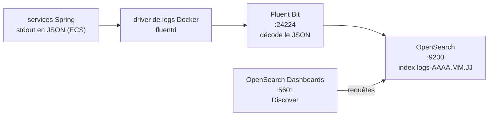

# Plan — Logs centralisés avec OpenSearch

28 octobre 2026 · Statut : implémenté.

## Contexte

Les logs des 3 services Spring (frontend, user-service, notification-service) sont rassemblés dans OpenSearch.

- **Avant :** il fallait lancer `docker compose logs <service>` pour chaque service.
- **Maintenant :** tous les logs se consultent et se filtrent au même endroit, dans OpenSearch Dashboards : par service, par niveau, par logger ou par texte.

Cela complète Prometheus et Grafana : les métriques disent « combien », les logs disent « quoi ».

**Le code Java ne change pas.** Tout passe par de la configuration.

## Circuit des logs

## Services Spring : logs JSON, sans code

Spring Boot sait écrire ses logs en JSON au format **ECS** (Elastic Common Schema). On l'active par une variable d'environnement, `LOGGING_STRUCTURED_FORMAT_CONSOLE: ecs`, posée dans `docker-compose.yml` sur les 3 services.

Ce réglage ne s'applique **que dans Docker**. En local (`java -jar`), les logs restent lisibles.

Chaque ligne devient un objet JSON avec ces champs :

- `@timestamp` : l'heure du log ;
- `log.level` et `log.logger` : le niveau et la classe qui a écrit le log ;
- `message` : le texte du log ;
- `service.name` : la valeur de `spring.application.name` ;
- `process.thread.name` : le thread ;
- en cas d'erreur, la stack trace.

## docker-compose

| Service | Image | Port hôte | Rôle |
| --- | --- | --- | --- |
| `opensearch` | `opensearchproject/opensearch:3.8.0` | 9200 | Stockage et recherche des logs |
| `opensearch-dashboards` | `opensearchproject/opensearch-dashboards:3.8.0` | 5601 | Interface web (Discover) |
| `fluent-bit` | `fluent/fluent-bit:5.1.4` | 24224 | Reçoit les logs de Docker et les envoie à OpenSearch |
| `opensearch-init` | `curlimages/curl:8.22.0` | — | Conteneur ponctuel de préparation, détaillé plus bas |

**OpenSearch** :

- il tourne sur un seul nœud (`single-node`) ;
- la sécurité est désactivée, donc ni TLS ni mot de passe. C'est une configuration de développement ;
- sa mémoire Java est fixée à 512 Mo.

**Les 3 services Spring** partagent un bloc `logging` commun, déclaré une fois dans une ancre YAML `x-spring-logging` :

- driver `fluentd`, qui envoie les logs à `localhost:24224` ;
- `fluentd-async: "true"`, pour qu'un service démarre même si Fluent Bit n'est pas encore prêt.

`docker compose logs` continue de fonctionner, grâce au cache local de Docker (le « dual logging »).

**`opensearch-init`** prépare l'environnement puis s'arrête :

1. il crée un modèle d'index sans réplique, pour que les index soient « green » sur un seul nœud ;
2. il crée l'index pattern `logs-*` dans Dashboards et le définit par défaut. Le script est dans `observability/opensearch/init-dashboards.sh`.

## Fluent Bit

La configuration se trouve dans `observability/fluent-bit/` : `fluent-bit.yaml` et `parsers.yaml`.

1. **Entrée `forward`** sur le port 24224. Docker y place chaque ligne de log dans un champ `log`.
2. **Renommage de `log` en `raw_log`.** Le JSON ECS contient lui-même un objet `log` (`log.level`, `log.logger`). Sans ce renommage, OpenSearch rejette les documents pour conflit de type.
3. **Parser JSON sur `raw_log`.** Les champs ECS deviennent des champs OpenSearch, et l'heure du log devient l'heure de l'événement.
4. **Lignes non JSON.** Ce sont les avertissements de la JVM au démarrage. Leur texte est placé dans `message`.
5. **Sortie `opensearch`** : un index par jour, `logs-AAAA.MM.JJ`.

## Vérification effectuée

1. `curl localhost:9200/_cat/indices/logs-*` : l'index du jour existe et il est **green**.
2. Création puis suppression d'un utilisateur. Ensuite, création d'un autre utilisateur pendant que notification-service est arrêté.
3. Dans OpenSearch, deux messages apparaissent :
   - le warning de user-service « Envoi de la notification impossible … UNAVAILABLE » ;
   - le log de notification-service « Utilisateur 1 supprimé : 1 notification(s) effacée(s) ».
4. Répartition des logs : environ 83 pour notification-service, 32 pour user-service et 14 pour frontend. S'y ajoutent les avertissements JVM, qui n'ont pas de `service.name`.
