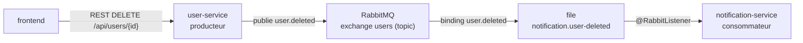

# Plan — RabbitMQ spring-ms

28 octobre 2026 · Statut : implémenté.

Pour comprendre le code, lire [RabbitMQ expliqué pas à pas](rabbitmq-explique.md).

## Contexte

RabbitMQ s'ajoute **en plus de gRPC** : les flux gRPC actuels (notification de bienvenue et comptage) ne changent pas.

RabbitMQ sert un nouveau cas, la suppression d'un utilisateur :

1. user-service publie un événement `user.deleted` ;
2. notification-service le consomme et supprime les notifications de cet utilisateur.

C'est l'illustration classique de l'asynchrone. La suppression réussit même si notification-service est arrêté : le message attend dans la file jusqu'à son redémarrage.

## Flux

Le message transporte seulement l'identifiant de l'utilisateur, en JSON : `{"userId": 42}`.

## user-service (producteur)

- **`pom.xml`** : `spring-boot-starter-amqp`. Vérifier le nom exact dans le BOM Boot 4.1.2.
- **`messaging/UserDeletedEvent`** : `record UserDeletedEvent(Long userId)`.
- **`messaging/MessagingConfig`** :
  - `TopicExchange("users")` durable ;
  - convertisseur JSON : `JacksonJsonMessageConverter` de Spring AMQP 4, ou l'équivalent Jackson disponible.
- **`messaging/UserEventPublisher`** : appelle `rabbitTemplate.convertAndSend("users", "user.deleted", event)`. Comme dans `NotificationClient`, une `AmqpException` est journalisée sans faire échouer la requête.
- **`UserController`** : nouvel endpoint `DELETE /api/users/{id}`.
  - Il supprime l'utilisateur puis publie l'événement.
  - Il répond 204, ou 404 si l'utilisateur est inconnu.
  - Il porte les mêmes annotations Swagger que les autres endpoints.
- **`application.yml`** :
  - `spring.rabbitmq.host` et `port` : localhost:5672, compte guest/guest ;
  - `spring.rabbitmq.template.observation-enabled: true`.

## notification-service (consommateur)

- **`pom.xml`** : `spring-boot-starter-amqp`.
- **`messaging/MessagingConfig`** :
  - exchange `users` ;
  - file durable `notification.user-deleted` ;
  - binding `user.deleted` ;
  - le même convertisseur JSON. Le type de l'objet reçu est déduit du paramètre du listener, donc aucune classe partagée entre les deux services n'est nécessaire.
- **`messaging/UserDeletedListener`** : `@RabbitListener(queues = "notification.user-deleted")`. Il reçoit un `UserDeletedEvent(Long userId)` et appelle `repository.deleteByUserId(userId)`, en `@Transactional`.
- **`NotificationRepository`** : ajout de `deleteByUserId(Long userId)`.
- **`application.yml`** :
  - connexion RabbitMQ ;
  - `spring.rabbitmq.listener.simple.observation-enabled: true`.

## frontend

- **`UserApiClient.delete(id)`** : appel `DELETE` via RestClient.
- **`WebController`** : nouvelle route `POST /users/{id}/delete`. Elle affiche le message flash « Utilisateur X supprimé » et redirige vers `/`. Les erreurs sont gérées comme dans `createUser`.
- **`user.html`** : bouton « Supprimer », dans un formulaire POST. Son style va dans `app.css`, en variante « danger » du thème sombre.

## docker-compose

| Service | Image | Ports hôte | Rôle |
| --- | --- | --- | --- |
| `rabbitmq` | `rabbitmq:4.3.7-management` | 5672, 15672 | Broker AMQP (5672) et console web (15672, guest/guest) |

- Le service `rabbitmq` a un healthcheck : `rabbitmq-diagnostics ping`.
- user-service et notification-service reçoivent :
  - la variable `SPRING_RABBITMQ_HOST: rabbitmq` ;
  - `depends_on` rabbitmq avec `condition: service_healthy`.

## Observabilité

Les observations Spring AMQP produisent deux familles de métriques :

- `spring_rabbit_template_seconds_*` : la publication ;
- `spring_rabbit_listener_seconds_*` : la consommation.

Le dashboard Grafana gagne **un seul panneau**, « Messages RabbitMQ / s ». Il montre les messages publiés par user-service et consommés par notification-service.

## Tests

- **`UserControllerTests`** : `RabbitTemplate` est remplacé par un `@MockitoBean`.
  - Test `deleteUserPublishesEvent` : la réponse est 204, et le test vérifie l'appel `convertAndSend("users", "user.deleted", new UserDeletedEvent(id))`.
  - Un id inconnu renvoie 404.
- **notification-service** : le test appelle directement `UserDeletedListener`, avec le vrai repository. Les notifications de l'utilisateur disparaissent, les autres restent. Les tests posent `spring.rabbitmq.listener.simple.auto-startup=false` pour ne pas exiger de broker.
- **frontend** : test du `POST /users/{id}/delete` quand user-service est indisponible ; on attend un message flash d'erreur.

## Documentation

- `README.md` :
  - RabbitMQ dans l'architecture ;
  - l'endpoint DELETE ;
  - la console <http://localhost:15672>.
- `DOCKER.md` : ports 5672 et 15672 dans le tableau.

## Vérification

1. `mvn clean install` : tous les tests passent.
2. `docker compose up -d --build`. Créer un utilisateur depuis le front, puis le supprimer : ses notifications disparaissent de la page d'accueil.
3. Console RabbitMQ (<http://localhost:15672>) : l'exchange `users` existe et la file `notification.user-deleted` lui est liée.
4. Arrêter notification-service (`docker compose stop notification-service`), puis supprimer un utilisateur : 1 message attend dans la file.
5. Le relancer (`docker compose start notification-service`) : le message est consommé et les notifications disparaissent.
6. Grafana : le panneau « Messages RabbitMQ / s » montre la publication et la consommation.
