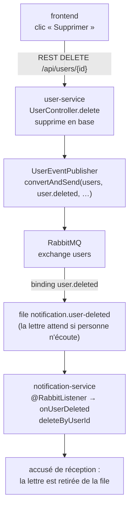

# RabbitMQ expliqué pas à pas

Ce document explique le code RabbitMQ du projet. On y suit **un seul message** : celui qui part quand on supprime un utilisateur avec le bouton « Supprimer » du front.

1. user-service supprime l'utilisateur, puis envoie un message.
2. notification-service reçoit ce message et efface les notifications de l'utilisateur.

Le choix de cette architecture est décrit dans le [plan RabbitMQ](plan-rabbitmq.md).

## Les 4 mots à connaître

Pour comprendre, une image simple : **la Poste**.

| Mot RabbitMQ | Dans l'image | Dans le projet |
| --- | --- | --- |
| **Message** | une lettre | `{"userId": 1}` |
| **Exchange** | le centre de tri | `users` |
| **Routing key** | l'adresse écrite sur la lettre | `user.deleted` |
| **Queue** (file) | une boîte aux lettres | `notification.user-deleted` |

Voici le trajet d'une lettre :

1. user-service dépose la lettre au **centre de tri** `users`, avec l'adresse `user.deleted`.
2. Le centre de tri applique ses règles de distribution, les **bindings**. Ici, la règle est : « les lettres `user.deleted` vont dans la boîte `notification.user-deleted` ».
3. La lettre reste dans la boîte jusqu'à ce que notification-service vienne la chercher. Si notification-service est arrêté, elle l'attend.

Le point clé : **user-service ne sait pas qui lira sa lettre**. Il la dépose au centre de tri et continue son travail sans attendre. C'est ce qu'on appelle l'asynchrone.

## Étape 1 : l'envoi (user-service)

### 1a. Le contrôleur supprime puis prévient

Dans [UserController.java](../user-service/src/main/java/com/example/user/api/UserController.java), méthode `delete` :

```java
repository.deleteById(id);   // supprime l'utilisateur en base
events.userDeleted(id);      // poste la lettre
return ResponseEntity.noContent().build();   // répond 204 tout de suite
```

Le contrôleur n'attend pas que les notifications soient effacées. Il poste la lettre et répond aussitôt.

### 1b. La lettre elle-même

Dans [UserDeletedEvent.java](../user-service/src/main/java/com/example/user/messaging/UserDeletedEvent.java) :

```java
public record UserDeletedEvent(Long userId) { }
```

C'est simplement la donnée transportée. Elle part en JSON : `{"userId": 1}`.

### 1c. Le facteur

Dans [UserEventPublisher.java](../user-service/src/main/java/com/example/user/messaging/UserEventPublisher.java) :

```java
rabbitTemplate.convertAndSend("users", "user.deleted", new UserDeletedEvent(userId));
//                             exchange  routing key      message
```

Le `RabbitTemplate` est fourni par Spring : on ne le crée pas soi-même. Il suffit de le demander dans le constructeur. Spring le livre déjà connecté à RabbitMQ, grâce aux réglages `spring.rabbitmq.*` du fichier `application.yml`.

Cet appel fait deux choses :

- il transforme l'objet en JSON ;
- il envoie ce JSON à l'exchange `users`.

Le `try/catch` autour de l'appel gère le cas où RabbitMQ est éteint. L'erreur est écrite dans les logs, mais la suppression de l'utilisateur réussit quand même.

### 1d. La configuration de l'envoi

[MessagingConfig.java](../user-service/src/main/java/com/example/user/messaging/MessagingConfig.java) déclare deux choses :

- `TopicExchange("users")` : le centre de tri `users` doit exister. Spring le crée dans RabbitMQ s'il n'existe pas encore.
- `JacksonJsonMessageConverter` : les objets sont envoyés en JSON, et non dans un format binaire propre à Java.

Le travail de user-service s'arrête là. La lettre se trouve dans la boîte `notification.user-deleted`. Cette boîte a été créée par notification-service, comme on le voit à l'étape 2.

## Étape 2 : la réception (notification-service)

Côté réception, il y a deux choses à faire : **installer la boîte aux lettres**, puis **la relever**.

### 2a. Installer la boîte et la règle de tri

Dans [MessagingConfig.java](../notification-service/src/main/java/com/example/notification/messaging/MessagingConfig.java) :

```java
@Bean
TopicExchange usersExchange() {
    return new TopicExchange("users");          // le centre de tri (même nom que côté user-service)
}

@Bean
Queue userDeletedQueue() {
    return new Queue("notification.user-deleted");   // ma boîte aux lettres
}

@Bean
Binding userDeletedBinding(Queue userDeletedQueue, TopicExchange usersExchange) {
    return BindingBuilder.bind(userDeletedQueue).to(usersExchange).with("user.deleted");
    //                    ma boîte          au centre « users »   pour l'adresse « user.deleted »
}
```

Au démarrage, Spring trouve ces 3 objets déclarés avec `@Bean`. Il demande alors à RabbitMQ de les créer s'ils n'existent pas.

**Pourquoi est-ce notification-service qui crée la boîte ?** Parce que c'est lui qui en a besoin. user-service ne connaît que le centre de tri. Imaginons qu'un 3ᵉ service veuille, lui aussi, être prévenu des suppressions. Il crée sa propre boîte avec la même règle, sans changer une ligne de user-service, et chaque boîte reçoit sa propre copie de la lettre.

**Pourquoi l'exchange est-il déclaré des deux côtés ?** Pour que l'ordre de démarrage des services n'ait pas d'importance. Le premier qui démarre crée l'exchange, le second constate qu'il existe déjà.

### 2b. Relever la boîte

Dans [UserDeletedListener.java](../notification-service/src/main/java/com/example/notification/messaging/UserDeletedListener.java) :

```java
@RabbitListener(queues = "notification.user-deleted")
@Transactional
public void onUserDeleted(UserDeletedEvent event) {
    long deleted = repository.deleteByUserId(event.userId());
    log.info(...);
}
```

`@RabbitListener` dit à Spring : « surveille cette boîte, et appelle cette méthode à chaque lettre ». On n'écrit ni boucle ni connexion : Spring s'en charge, en tâche de fond.

Quand une lettre arrive, Spring fait trois choses :

1. Il lit le JSON `{"userId": 1}`.
2. Il le transforme en `UserDeletedEvent`. Pour savoir quel type créer, il regarde le **paramètre de la méthode**. C'est pourquoi notification-service a sa propre copie du record `UserDeletedEvent` : les deux services ne partagent pas de classe Java, seulement la forme du JSON.
3. Il appelle `onUserDeleted(event)`.

`@Transactional` vient de JPA. Une suppression « par userId » doit s'exécuter dans une transaction : cette annotation en ouvre une autour de la méthode.

### 2c. L'accusé de réception (« ack »)

Ce mécanisme ne se voit pas dans le code, mais il est essentiel :

- **La méthode se termine normalement.** Spring répond à RabbitMQ « c'est traité », et la lettre est retirée de la boîte.
- **La méthode lève une exception.** La lettre n'est pas confirmée, et RabbitMQ la représente.
- **Le service est arrêté.** Personne ne relève la boîte, et la lettre attend son retour.

Grâce à cet accusé de réception, aucun message n'est perdu.

## Le parcours complet



## Pour le voir en vrai

1. Lancer la stack : `docker compose up -d`.
2. Ouvrir la console RabbitMQ sur <http://localhost:15672> (identifiants `guest` / `guest`). Dans l'onglet *Exchanges*, cliquer sur `users` : la section *Bindings* montre la règle vers la file `notification.user-deleted`.
3. Arrêter le consommateur : `docker compose stop notification-service`.
4. Supprimer un utilisateur depuis le front.
5. Dans l'onglet *Queues*, la file affiche 1 message en attente. Le compteur peut mettre quelques secondes à se rafraîchir.
6. Relancer le consommateur : `docker compose start notification-service`. Le message est consommé, et les logs (`docker compose logs notification-service`) affichent « Utilisateur X supprimé ».
